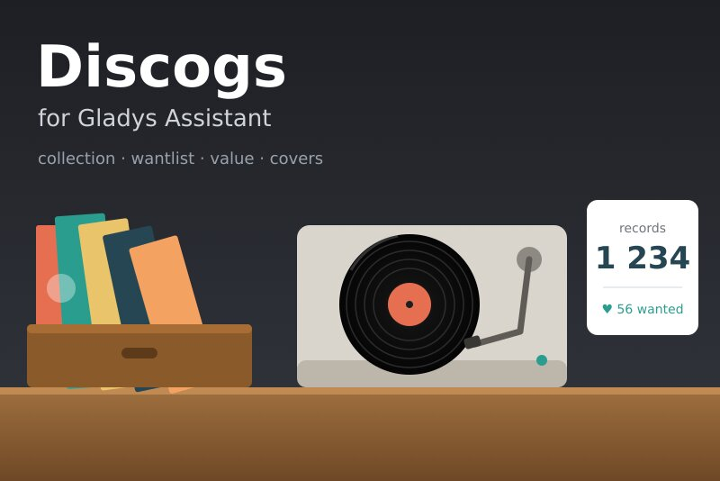
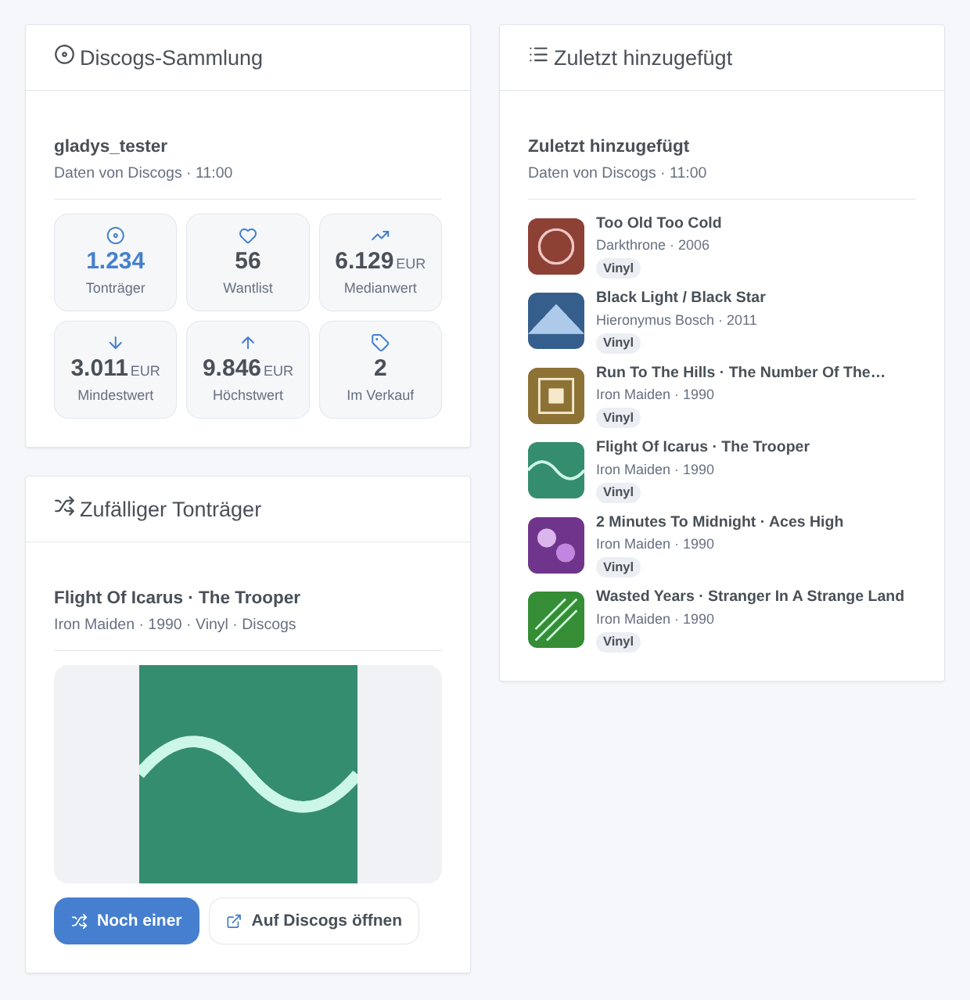
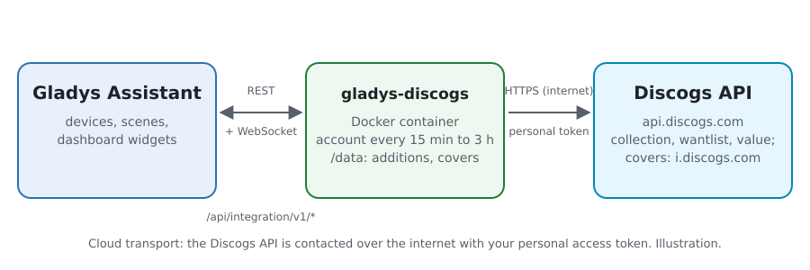
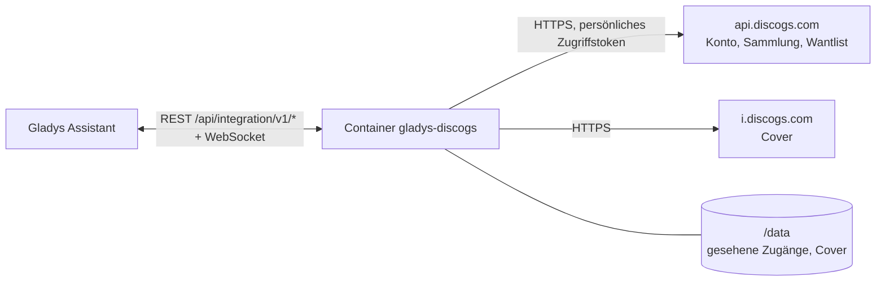
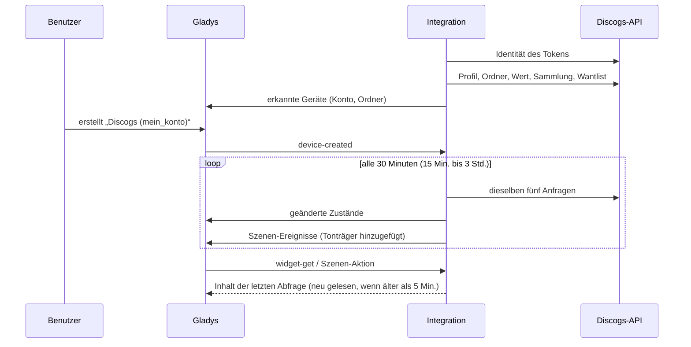

# Gladys Discogs

[English](README.md) · [Français](README.fr.md) · **Deutsch** · [Español](README.es.md)

[](LICENSE)
[](https://github.com/William-De71/gladys-discogs/releases)
[](https://github.com/William-De71/gladys-discogs/actions/workflows/release.yml)
[](https://gladysassistant.com)



Externe Integration für [Gladys Assistant](https://gladysassistant.com) rund um deine **[Discogs](https://www.discogs.com)-Plattensammlung**: Tonträger, Wantlist, Wert der Sammlung und Ordner als Geräte, Neuzugänge als Szenen-Auslöser und Widgets mit den Covern. Sie nutzt die offizielle Discogs-API mit einem persönlichen Zugriffstoken deines Kontos.

Benutzerdokumentation: [English](docs/en.md) · [Français](docs/fr.md) · [Deutsch](docs/de.md) · [Español](docs/es.md).

> Community-Integration, weder mit Discogs verbunden noch von Discogs unterstützt. Daten von Discogs.

## Funktionen

- **Das Konto-Gerät**: Tonträger in der Sammlung, in der Wantlist und im Verkauf, minimaler / mittlerer / maximaler Wert der Sammlung (von Discogs anhand der Marktplatz-Verkäufe geschätzt), zuletzt hinzugefügter Tonträger.
- **Ein Gerät pro Ordner** der Sammlung („Vinyl“, „CD“…), mit der Anzahl seiner Tonträger.
- **2 Szenen-Auslöser**: ein Tonträger wurde zur Sammlung hinzugefügt (Filter nach Ordner und Format), ein Tonträger wurde zur Wantlist hinzugefügt.
- **7 Szenen-Aktionen**: ein zufälliger Tonträger („Was lege ich heute Abend auf?“), Strichcode suchen, eine Veröffentlichung zur Sammlung hinzufügen, zur Wantlist hinzufügen oder von ihr entfernen, Preis eines Tonträgers auf dem Marktplatz, die Sammlung in einem Satz.
- **3 Dashboard-Widgets**: die Sammlung auf einen Blick, die zuletzt hinzugefügten Tonträger (mit Covern), ein zufälliger Tonträger mit großem Cover und einem Knopf, um einen neuen zu ziehen.
- **Knöpfe in der Konfiguration**: Verbindung testen, Diagnose.
- Fünf Anfragen pro Abfrage (alle 15 Minuten bis 3 Stunden, standardmäßig 30 Minuten), eine nach der anderen, innerhalb der 60 Anfragen pro Minute der API; vier Sprachen (Englisch, Französisch, Deutsch, Spanisch).



## So funktioniert es





Beim Start fragt die Integration Discogs, zu welchem Konto das Token gehört (`/oauth/identity`), und liest dann bei jeder Abfrage das Profil (Zähler, Währung), die Ordner, den Wert der Sammlung sowie die erste Seite der Sammlung und der Wantlist, die neuesten Einträge zuerst. Sie veröffentlicht die geänderten Zustände und vergleicht die beiden ersten Seiten mit denen der vorherigen Abfrage, um die Szenen-Auslöser zu starten. Die Cover werden nur dann vom Bildserver von Discogs geladen, wenn ein Widget sie anzeigt.



### Transport

Nur Cloud (`"transports": ["cloud"]`): Der Katalog zeigt das Cloud-Abzeichen, und es gibt keinen Knopf „lokale Verbindung bevorzugen“. Die Integration kontaktiert `api.discogs.com` und für die Cover `i.discogs.com`. Das Token bleibt in Gladys und im Container; der Knopf **Diagnose** zeigt nur seine letzten vier Zeichen.

## Geräte und Funktionen

| Gerät                | Funktion                               | Kategorie / Typ            | Bereich                 |
| -------------------- | -------------------------------------- | -------------------------- | ----------------------- |
| Discogs (dein Konto) | Tonträger in der Sammlung              | `counter-sensor` / integer | 0 – 10 000 000          |
| Discogs (dein Konto) | Tonträger in der Wantlist              | `counter-sensor` / integer | 0 – 10 000 000          |
| Discogs (dein Konto) | Tonträger im Verkauf                   | `counter-sensor` / integer | 0 – 10 000 000          |
| Discogs (dein Konto) | Wert der Sammlung (min., Median, max.) | `currency` / decimal       | € / $ / £ wie das Konto |
| Discogs (dein Konto) | Zuletzt hinzugefügter Tonträger        | `text` / text              | —                       |
| Ordner (Discogs)     | Tonträger im Ordner                    | `counter-sensor` / integer | 0 – 10 000 000          |

Externe IDs: `account:<account id>` und `folder:<account id>_<folder id>` — die numerischen IDs von Discogs, niemals die Namen. Die Werte sind in der Währung des Discogs-Kontos; Gladys kennt eine Einheit für Euro, Dollar und Pfund, die anderen Währungen haben keine. `should_poll` ist false: Die Integration liest nach ihrem eigenen Zeitplan.

## Szenen-Auslöser, Aktionen und Widgets

| Art      | Schlüssel              | Verwendung                                                                                  |
| -------- | ---------------------- | ------------------------------------------------------------------------------------------- |
| Auslöser | `collection_added`     | Ein Tonträger wurde zur Sammlung hinzugefügt; Filter: Ordner-Gerät, Format.                 |
| Auslöser | `wantlist_added`       | Ein Tonträger wurde zur Wantlist hinzugefügt; Filter: Format.                               |
| Aktion   | `random_release`       | Ein zufällig gezogener Tonträger aus der Sammlung oder einem Ordner.                        |
| Aktion   | `search_barcode`       | Die Veröffentlichung, auf der der Strichcode steht, die meistbesessene Pressung zuerst.     |
| Aktion   | `add_to_collection`    | Eine Veröffentlichung zu einem Ordner hinzufügen (kein zweites Exemplar, außer auf Wunsch). |
| Aktion   | `add_to_wantlist`      | Eine Veröffentlichung zur Wantlist hinzufügen.                                              |
| Aktion   | `remove_from_wantlist` | Eine Veröffentlichung von der Wantlist entfernen.                                           |
| Aktion   | `get_price`            | Angebote auf dem Marktplatz und der niedrigste Preis.                                       |
| Aktion   | `get_collection`       | Zähler und Wert der Sammlung sowie ein fertiger Satz.                                       |
| Widget   | `collection`           | Tonträger, Wantlist, Wert (min., Median, max.), im Verkauf.                                 |
| Widget   | `recent`               | Die zuletzt zur Sammlung oder Wantlist hinzugefügten Tonträger, mit Covern.                 |
| Widget   | `random`               | Ein zufälliger Tonträger, sein großes Cover, „Noch einer“ und „Auf Discogs öffnen“.         |

Die Variablen der Auslöser liefern Release-Nummer, Titel, Künstler, Jahr, Format, Label, Katalognummer, Genre, Seite und Cover des Tonträgers. Die erste Abfrage eines Kontos dient als Ausgangsbasis, und die zuletzt gesehenen Zugänge werden in `/data` gespeichert: Ein Neustart löst nie zweimal dasselbe Ereignis aus, und ein Tonträger, der durch eine Szenen-Aktion hinzugefügt wurde, löst nichts aus. Ein Massenimport löst höchstens 10 Ereignisse pro Abfrage aus.

Beispiele:

- „Tonträger zur Sammlung hinzugefügt“, Format Vinyl → „Neu in der Sammlung: {{artist}} – {{title}}“ an dein Handy schicken.
- Jeden Freitag um 20:00 Uhr → „Discogs: ein zufälliger Tonträger“ aus dem Ordner Vinyl → die Zusammenfassung über den Lautsprecher im Wohnzimmer ansagen.
- Ein Strichcode-Scanner schickt seinen Code an eine Szene → „Strichcode suchen“, dann „zur Sammlung hinzufügen“ mit der gefundenen Release-Nummer.

## Voraussetzungen

- Gladys Assistant **5.3.0** oder neuer (Widgets, Szenen-Auslöser und -Aktionen externer Integrationen, Katalog-Schlagwörter von Gladys 5.3). Ältere Installationen können die Integration nicht installieren.
- Ein Discogs-Konto und ein **persönliches Zugriffstoken**: auf discogs.com unter Settings → Developers → **Generate new token**.

## Installation

- **Aus dem Store** von Gladys (Integrationen → Externe Integrationen), mit einem Klick, sobald sie indexiert ist.
- **Über die URL des Repositorys**: `https://github.com/William-De71/gladys-discogs`.
- **Entwicklermodus**: das Image lokal bauen (`docker build -t gladys-discogs .`) und aus Gladys heraus installieren.

## Konfiguration

| Feld                       | Beschreibung                                                                                      |
| -------------------------- | ------------------------------------------------------------------------------------------------- |
| Persönliches Zugriffstoken | Das Token aus Settings → Developers auf discogs.com (geheim, Pflichtfeld).                        |
| Abfrage des Kontos         | Alle 15 Minuten, 30 Minuten (Standard), stündlich oder alle 3 Stunden. Fünf Anfragen pro Abfrage. |
| Währung der Preise         | Währung der Aktion „Preis eines Tonträgers“. Standard: die des Kontos.                            |
| Sprache der Texte          | Namen der Funktionen, Zusammenfassungen in Szenen und Ausgaben.                                   |

Knöpfe: **Verbindung testen** (liest das Konto sofort und bietet seine Geräte an) und **Diagnose** (schreibt Konto, Zähler, zuletzt gesehene Zugänge, letzten Fehler und verbleibendes Anfragekontingent in den Reiter Logs, das Token verborgen).

## Verwendung

1. Erzeuge auf discogs.com ein Token (Settings → Developers), füge es ein, speichere und drück auf **Verbindung testen**.
2. Erstelle im Reiter **Geräteerkennung** das Konto-Gerät und die Ordner, die du möchtest.
3. Füge die Widgets **Discogs-Sammlung**, **Zuletzt hinzugefügt** und **Zufälliger Tonträger** zu einem Dashboard hinzu und bau Szenen mit den oben genannten Auslösern und Aktionen.

## Entwicklung

```bash
npm install
npm test                       # node --test, never touches the network
npm run lint && npm run format:check
npx github:GladysAssistant/integration-store . --skip-image-check
scripts/build-cover.sh         # cover.jpg from docs/assets/cover.svg
docs/illustrations/render.sh   # docs/assets/widgets.<lang>.png
node .github/scripts/release.mjs next
```

Lokal liest das SDK `GLADYS_HOST_API_URL`, `GLADYS_INTEGRATION_TOKEN` und `GLADYS_INTEGRATION_SELECTOR`; `DISCOGS_API_URL` leitet die Integration auf eine andere API-Wurzel um (einen Mock); `DEBUG=gladys-integration-sdk` zeigt die Logs des SDK und prüft jeden Widget-Inhalt. Die Tests verwenden echte, gekürzte Antworten der Discogs-API (`test/fixtures/`). Die Regeln des Projekts stehen in [CLAUDE.md](CLAUDE.md).

## Release-Prozess


Jeder Merge auf `main` startet die CI und berechnet dann die Version aus den [Conventional Commits](https://www.conventionalcommits.org/) seit dem letzten Tag: `feat` → Minor, `fix` / `perf` → Patch, `!` oder `BREAKING CHANGE` → Major (unter 1.0.0 ein Minor); `docs`, `chore`, `ci`, `test`, `style`, `refactor`, `build` allein veröffentlichen nichts. Der Changelog-Abschnitt wird generiert, der Tag gepusht, das Multi-Architektur-Image gebaut, dann erhält `main` den Release-Commit, das GitHub Release wird erstellt und ein letzter Job prüft das öffentliche Image, den Store-Validator und das Topic.

- Der Titel des Pull Requests wird zum Squash-Commit und dann zur Changelog-Zeile: Schreib ihn auf Englisch, für die Benutzer (`pr-title.yml` prüft ihn). Bearbeite `CHANGELOG.md` niemals von Hand.
- 1.0.0 ist eine bewusste Entscheidung: Actions → Release → Run workflow mit `release-as: 1.0.0`. `dry-run` zeigt Version und Notizen, ohne zu veröffentlichen.
- **Geschützter Branch**: Das Release pusht seinen Commit mit `GITHUB_TOKEN` auf `main`. Ist ein Ruleset auf `main` strenger als „kein Löschen, kein Force-Push“, füge GitHub Actions zu seiner Bypass-Liste hinzu (oder pushe über eine GitHub App), sonst schlägt der Veröffentlichungs-Job mit einer Anleitung fehl.
- Mach nach dem ersten Release das Paket auf `ghcr.io` öffentlich (Package settings → Change visibility), sonst kann Gladys es nicht herunterladen.

## Fehlerbehebung

Siehe [docs/de.md](docs/de.md#fehlerbehebung). Melde Probleme mit den Versionen von Gladys und der Integration, der betroffenen Veröffentlichung oder Funktion und den Zeilen des Knopfs **Diagnose** — niemals mit deinem Token.

## Mitwirken

Issues und Pull Requests sind willkommen. Führ vor dem Öffnen eines Pull Requests `npm run format:check && npm run lint && npm test` aus und lass jede externe ID und jeden gespeicherten Schlüssel unverändert (siehe [CLAUDE.md](CLAUDE.md)).

## Sicherheit

Siehe [SECURITY.md](SECURITY.md): Melde Sicherheitslücken vertraulich. Das persönliche Zugriffstoken ist ein `secret`-Feld: Es wird nie protokolliert und nur an `api.discogs.com` gesendet. Die Integration läuft schreibgeschützt, als Nicht-Root-Benutzer, in ihrem Container und lädt Cover nur von `i.discogs.com`.

## Screenshots folgen

Die Bilder oben sind Illustrationen, keine Screenshots. Echte Screenshots kommen nach `docs/assets/screenshots/` (PNG, 1280 × 800): `configuration.png`, `discovery.png`, `device.png`, `scene.png`.

## Lizenz

[Apache License 2.0](LICENSE) — siehe auch [NOTICE](NOTICE). Die Daten stammen von [Discogs](https://www.discogs.com) über die [offizielle API](https://www.discogs.com/developers), gemäß den Nutzungsbedingungen der Discogs-API: Die Widgets zeigen „Daten von Discogs“. Discogs ist eine Marke von Zink Media, LLC. Danke an die Dokumentation und das SDK von Gladys.
