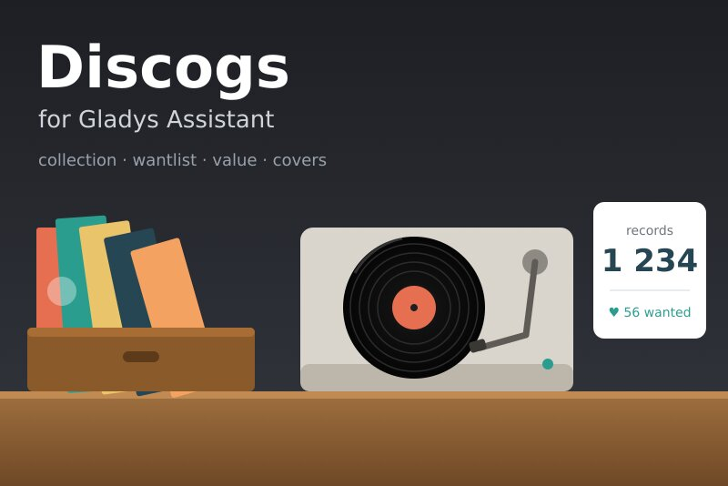
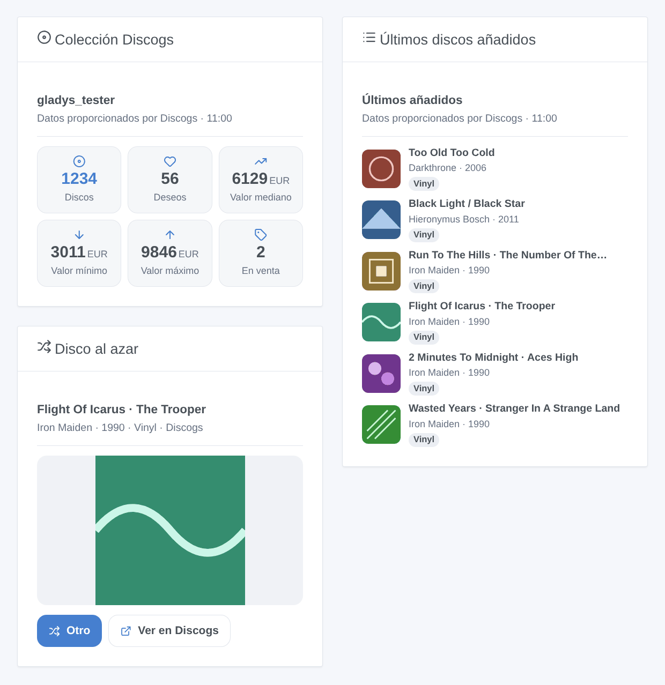
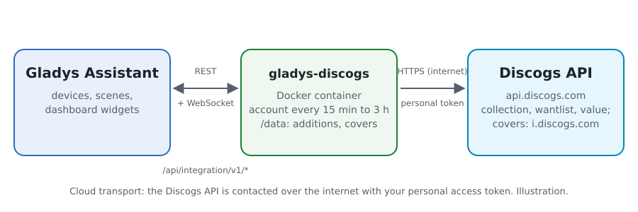
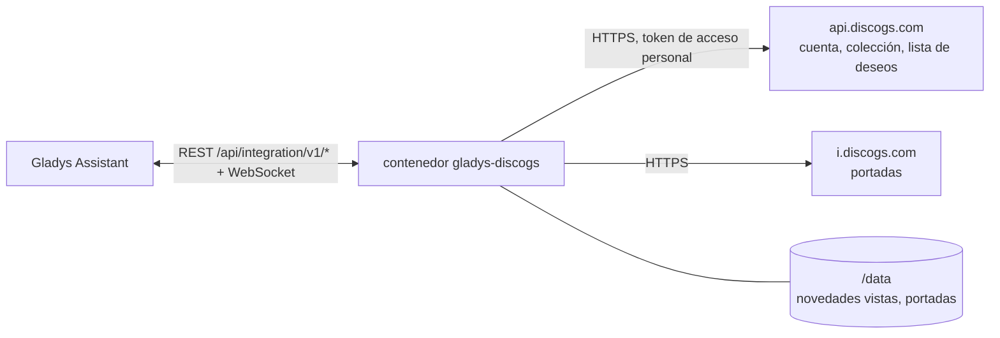
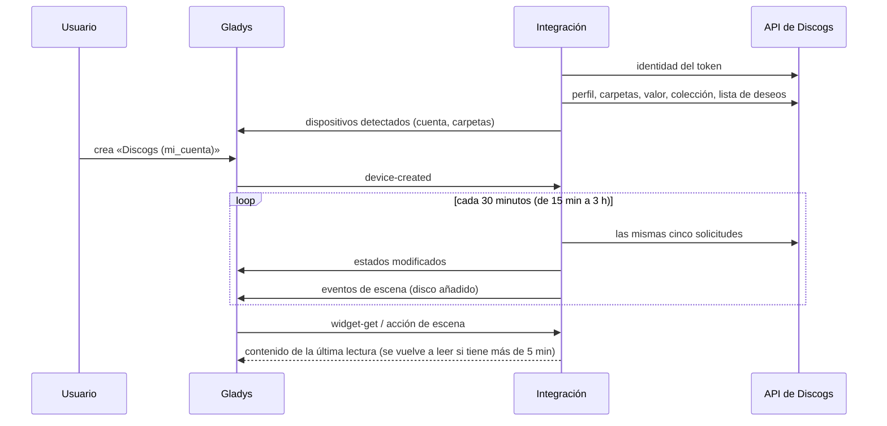

# Gladys Discogs

[English](README.md) · [Français](README.fr.md) · [Deutsch](README.de.md) · **Español**

[](LICENSE)
[](https://github.com/William-De71/gladys-discogs/releases)
[](https://github.com/William-De71/gladys-discogs/actions/workflows/release.yml)
[](https://gladysassistant.com)



Integración externa de [Gladys Assistant](https://gladysassistant.com) para tu **colección de discos de [Discogs](https://www.discogs.com)**: discos, lista de deseos, valor de la colección y carpetas como dispositivos, las novedades como desencadenantes de escena, y widgets con las portadas. Usa la API oficial de Discogs con un token de acceso personal de tu cuenta.

Documentación de usuario: [English](docs/en.md) · [Français](docs/fr.md) · [Deutsch](docs/de.md) · [Español](docs/es.md).

> Integración comunitaria, sin relación con Discogs ni respaldada por Discogs. Datos proporcionados por Discogs.

## Funcionalidades

- **El dispositivo de la cuenta**: discos en la colección, en la lista de deseos y a la venta, valor mínimo / mediano / máximo de la colección (estimado por Discogs a partir de las ventas del mercado), último disco añadido.
- **Un dispositivo por carpeta** de la colección («Vinilos», «CD»…), con su número de discos.
- **2 desencadenantes de escena**: un disco añadido a la colección (filtrado por carpeta y por formato), un disco añadido a la lista de deseos.
- **7 acciones de escena**: un disco al azar («¿qué pongo esta noche?»), buscar un código de barras, añadir una edición a la colección, añadirla a la lista de deseos o quitarla, precio de un disco en el mercado, la colección en una frase.
- **3 widgets de panel**: la colección de un vistazo, los últimos discos añadidos (con portadas), un disco al azar con su portada grande y un botón para sacar otro.
- **Botones de configuración**: probar la conexión, diagnóstico.
- Cinco solicitudes por lectura (cada 15 minutos a 3 horas, 30 minutos por defecto), una tras otra, dentro de las 60 solicitudes por minuto de la API; cuatro idiomas (inglés, francés, alemán, español).



## Funcionamiento





Al arrancar, la integración pregunta a Discogs a qué cuenta pertenece el token (`/oauth/identity`); después, en cada lectura, lee el perfil (recuentos, moneda), las carpetas, el valor de la colección y la primera página de la colección y de la lista de deseos, con lo último añadido primero. Publica los estados que han cambiado y compara las dos primeras páginas con las de la lectura anterior para lanzar los desencadenantes de escena. Las portadas solo se leen del servidor de imágenes de Discogs cuando un widget las muestra.



### Transporte

Solo nube (`"transports": ["cloud"]`): el catálogo muestra la insignia de nube y no hay botón «preferir la conexión local». La integración contacta con `api.discogs.com` y, para las portadas, con `i.discogs.com`. El token se queda en Gladys y en el contenedor; el botón **Diagnóstico** solo muestra sus cuatro últimos caracteres.

## Dispositivos y funcionalidades

| Dispositivo       | Funcionalidad                               | Categoría / tipo           | Rango                     |
| ----------------- | ------------------------------------------- | -------------------------- | ------------------------- |
| Discogs (cuenta)  | Discos en la colección                      | `counter-sensor` / integer | 0 – 10 000 000            |
| Discogs (cuenta)  | Discos en la lista de deseos                | `counter-sensor` / integer | 0 – 10 000 000            |
| Discogs (cuenta)  | Discos a la venta                           | `counter-sensor` / integer | 0 – 10 000 000            |
| Discogs (cuenta)  | Valor de la colección (mín., mediano, máx.) | `currency` / decimal       | € / $ / £ según la cuenta |
| Discogs (cuenta)  | Último disco añadido                        | `text` / text              | —                         |
| Carpeta (Discogs) | Discos en la carpeta                        | `counter-sensor` / integer | 0 – 10 000 000            |

Identificadores externos: `account:<account id>` y `folder:<account id>_<folder id>` — los identificadores numéricos de Discogs, nunca los nombres. Los valores están en la moneda de la cuenta de Discogs; Gladys tiene una unidad para el euro, el dólar y la libra, las demás monedas no tienen. `should_poll` es false: la integración lee con su propio temporizador.

## Desencadenantes, acciones de escena y widgets

| Tipo           | Clave                  | Uso                                                                              |
| -------------- | ---------------------- | -------------------------------------------------------------------------------- |
| Desencadenante | `collection_added`     | Un disco añadido a la colección; filtros: dispositivo carpeta, formato.          |
| Desencadenante | `wantlist_added`       | Un disco añadido a la lista de deseos; filtro: formato.                          |
| Acción         | `random_release`       | Un disco de la colección o de una carpeta, sacado al azar.                       |
| Acción         | `search_barcode`       | La edición impresa con un código de barras, primero el prensaje más poseído.     |
| Acción         | `add_to_collection`    | Añade una edición a una carpeta (sin segunda copia salvo que se pida).           |
| Acción         | `add_to_wantlist`      | Añade una edición a la lista de deseos.                                          |
| Acción         | `remove_from_wantlist` | Quita una edición de la lista de deseos.                                         |
| Acción         | `get_price`            | Copias a la venta en el mercado y el precio más bajo.                            |
| Acción         | `get_collection`       | Recuentos y valor de la colección, y una frase.                                  |
| Widget         | `collection`           | Discos, lista de deseos, valor (mín., mediano, máx.), a la venta.                |
| Widget         | `recent`               | Los últimos discos añadidos a la colección o a la lista de deseos, con portadas. |
| Widget         | `random`               | Un disco al azar, su portada grande, «Otro» y «Ver en Discogs».                  |

Las variables de los desencadenantes dan el número de edición, el título, el artista, el año, el formato, el sello, el número de catálogo, el género, la página y la portada del disco. La primera lectura de una cuenta sirve de referencia, y las últimas novedades vistas se guardan en `/data`: un reinicio nunca lanza dos veces el mismo evento, y un disco añadido por una acción de escena no lanza nada. Una importación masiva lanza como mucho 10 eventos por lectura.

Ejemplos:

- «Disco añadido a la colección», formato Vinilo → envía «Nuevo en la colección: {{artist}} – {{title}}» a tu móvil.
- Todos los viernes a las 20:00 → «un disco al azar» de la carpeta Vinilos → di su resumen por el altavoz del salón.
- Un lector de códigos de barras envía su código a una escena → «buscar un código de barras» y luego «añadir a la colección» con el número de edición encontrado.

## Requisitos

- Gladys Assistant **5.3.0** o posterior (widgets, desencadenantes y acciones de escena de las integraciones externas, palabras clave del catálogo de Gladys 5.3). Las instancias más antiguas no pueden instalar la integración.
- Una cuenta de Discogs y un **token de acceso personal**: en discogs.com, Settings → Developers → **Generate new token**.

## Instalación

- **Desde la tienda** de Gladys (Integraciones → Integraciones externas), en un clic, una vez indexada.
- **Desde la URL del repositorio**: `https://github.com/William-De71/gladys-discogs`.
- **Modo desarrollador**: construye la imagen en local (`docker build -t gladys-discogs .`) e instálala desde Gladys.

## Configuración

| Campo                    | Descripción                                                                               |
| ------------------------ | ----------------------------------------------------------------------------------------- |
| Token de acceso personal | El token de Settings → Developers en discogs.com (secreto, obligatorio).                  |
| Lectura de la cuenta     | Cada 15 minutos, 30 minutos (por defecto), hora o 3 horas. Cinco solicitudes por lectura. |
| Moneda de los precios    | Moneda de la acción «precio de un disco». Por defecto: la de la cuenta.                   |
| Idioma de los textos     | Nombres de las funcionalidades, resúmenes de escena y salidas.                            |

Botones: **Probar la conexión** (lee la cuenta en el momento y ofrece sus dispositivos) y **Diagnóstico** (escribe en la pestaña de registros la cuenta, los recuentos, las últimas novedades vistas, el último error y el margen de solicitudes que queda, con el token oculto).

## Uso

1. Genera un token en discogs.com (Settings → Developers), pégalo, guarda y pulsa **Probar la conexión**.
2. En la pestaña **Detección**, crea el dispositivo de la cuenta y las carpetas que quieras.
3. Añade los widgets **Colección Discogs**, **Últimos discos añadidos** y **Disco al azar** a un panel, y crea escenas con los desencadenantes y acciones de arriba.

## Desarrollo

```bash
npm install
npm test                       # node --test, nunca accede a la red
npm run lint && npm run format:check
npx github:GladysAssistant/integration-store . --skip-image-check
scripts/build-cover.sh         # cover.jpg a partir de docs/assets/cover.svg
docs/illustrations/render.sh   # docs/assets/widgets.<lang>.png
node .github/scripts/release.mjs next
```

En local, el SDK lee `GLADYS_HOST_API_URL`, `GLADYS_INTEGRATION_TOKEN` y `GLADYS_INTEGRATION_SELECTOR`; `DISCOGS_API_URL` dirige la integración a otra raíz de API (un simulador); `DEBUG=gladys-integration-sdk` muestra los registros del SDK y comprueba cada contenido de widget. Las pruebas usan respuestas reales de la API de Discogs, recortadas (`test/fixtures/`). Las reglas del proyecto están en [CLAUDE.md](CLAUDE.md).

## Proceso de publicación


Cada fusión en `main` ejecuta la CI y luego calcula la versión a partir de los [Conventional Commits](https://www.conventionalcommits.org/) desde la última etiqueta: `feat` → menor, `fix` / `perf` → parche, `!` o `BREAKING CHANGE` → mayor (una menor por debajo de 1.0.0); `docs`, `chore`, `ci`, `test`, `style`, `refactor`, `build` solos no publican nada. La sección del changelog se genera, se envía la etiqueta, se construye la imagen multiarquitectura, después `main` recibe el commit de publicación, se crea la GitHub Release y un último job comprueba la imagen pública, el validador de la tienda y el topic.

- El título de la pull request se convierte en el commit de squash y luego en la línea del changelog: escríbelo en inglés, pensando en el usuario (`pr-title.yml` lo comprueba). Nunca edites `CHANGELOG.md` a mano.
- La 1.0.0 es una decisión: Actions → Release → Run workflow con `release-as: 1.0.0`. `dry-run` muestra la versión y las notas sin publicar.
- **Rama protegida**: la publicación envía su commit a `main` con `GITHUB_TOKEN`. Si hay un ruleset en `main` más estricto que «sin borrado, sin force-push», añade GitHub Actions a su lista de excepciones (o envía a través de una GitHub App); si no, el job de publicación falla con instrucciones.
- Tras la primera publicación, haz público el paquete `ghcr.io` (Package settings → Change visibility), o Gladys no podrá descargarlo.

## Solución de problemas

Consulta [docs/es.md](docs/es.md#solución-de-problemas). Informa de los problemas indicando las versiones de Gladys y de la integración, la edición o la funcionalidad afectada y las líneas del botón **Diagnóstico** — nunca tu token.

## Contribuir

Las incidencias y pull requests son bienvenidas. Ejecuta `npm run format:check && npm run lint && npm test` antes de abrir una pull request, y no cambies ningún identificador externo ni ninguna clave guardada (consulta [CLAUDE.md](CLAUDE.md)).

## Seguridad

Consulta [SECURITY.md](SECURITY.md): informa de las vulnerabilidades en privado. El token de acceso personal es un campo `secret`: nunca se registra en los logs ni se envía a otro sitio que no sea `api.discogs.com`. La integración se ejecuta en solo lectura, como usuario no root, en su contenedor, y solo lee portadas de `i.discogs.com`.

## Capturas por venir

Las imágenes de arriba son ilustraciones, no capturas de pantalla. Las capturas reales irán en `docs/assets/screenshots/` (PNG, 1280 × 800): `configuration.png`, `discovery.png`, `device.png`, `scene.png`.

## Licencia

[Apache License 2.0](LICENSE) — consulta también [NOTICE](NOTICE). Los datos proceden de [Discogs](https://www.discogs.com) a través de su [API oficial](https://www.discogs.com/developers), según las condiciones de uso de la API de Discogs: los widgets muestran «Datos proporcionados por Discogs». Discogs es una marca de Zink Media, LLC. Gracias a la documentación y al SDK de Gladys.
