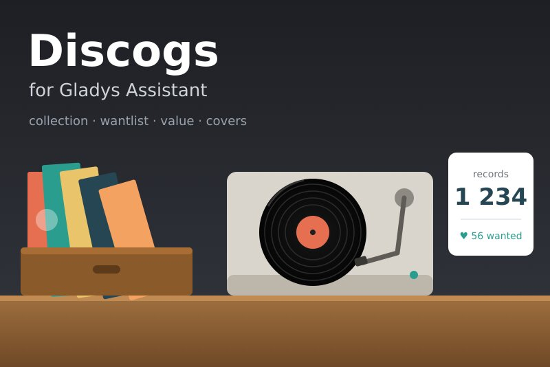
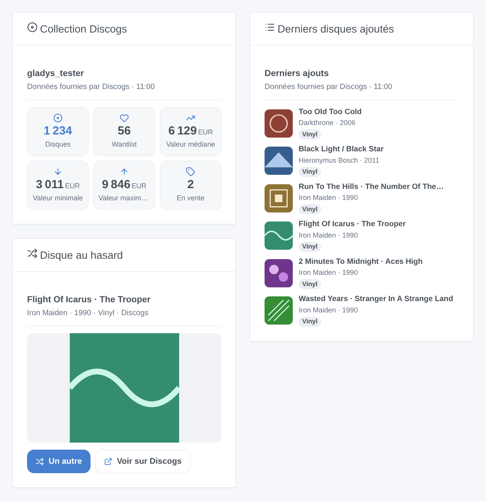
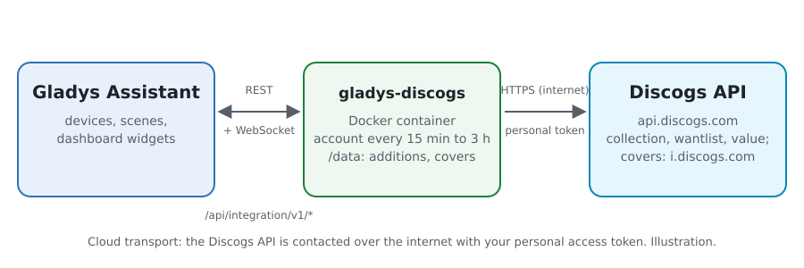
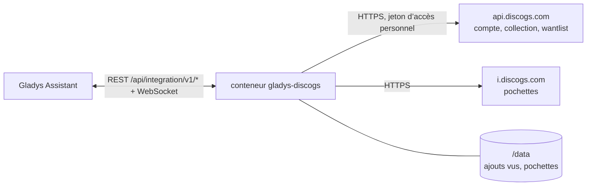
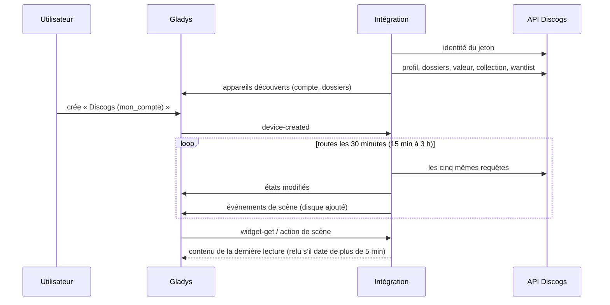

# Gladys Discogs

[English](README.md) · **Français** · [Deutsch](README.de.md) · [Español](README.es.md)

[](LICENSE)
[](https://github.com/William-De71/gladys-discogs/releases)
[](https://github.com/William-De71/gladys-discogs/actions/workflows/release.yml)
[](https://gladysassistant.com)



Intégration externe pour [Gladys Assistant](https://gladysassistant.com) qui amène votre **[collection de disques Discogs](https://www.discogs.com)** : disques, wantlist, valeur de la collection et dossiers en appareils, nouveaux ajouts en déclencheurs de scène, et widgets avec les pochettes. Elle passe par l’API officielle de Discogs, avec un jeton d’accès personnel de votre compte.

Documentation utilisateur : [English](docs/en.md) · [Français](docs/fr.md) · [Deutsch](docs/de.md) · [Español](docs/es.md).

> Intégration communautaire, sans lien avec Discogs ni approuvée par Discogs. Données fournies par Discogs.

## Fonctionnalités

- **L’appareil du compte** : disques dans la collection, dans la wantlist et en vente, valeur minimale / médiane / maximale de la collection (estimée par Discogs d’après les ventes du marché), dernier disque ajouté.
- **Un appareil par dossier** de la collection (« Vinyles », « CD »…), avec son nombre de disques.
- **2 déclencheurs de scène** : un disque ajouté à la collection (filtré par dossier et par format), un disque ajouté à la wantlist.
- **7 actions de scène** : un disque au hasard (« qu’est-ce que j’écoute ce soir ? »), chercher un code-barres, ajouter une édition à la collection, l’ajouter à la wantlist ou l’en retirer, prix d’un disque sur le marché, la collection en une phrase.
- **3 widgets de tableau de bord** : la collection en un coup d’œil, les derniers disques ajoutés (avec pochettes), un disque au hasard avec sa grande pochette et un bouton pour en tirer un autre.
- **Boutons de configuration** : tester la connexion, diagnostic.
- Cinq requêtes par lecture (toutes les 15 minutes à 3 heures, 30 minutes par défaut), une à la fois, dans la limite des 60 requêtes par minute de l’API ; quatre langues (anglais, français, allemand, espagnol).



## Fonctionnement





Au démarrage, l’intégration demande à Discogs à quel compte appartient le jeton (`/oauth/identity`), puis lit à chaque lecture le profil (nombres, devise), les dossiers, la valeur de la collection et la première page de la collection et de la wantlist, les derniers ajouts en tête. Elle publie les états qui ont changé et compare ces deux premières pages avec celles de la lecture précédente pour lancer les déclencheurs de scène. Les pochettes ne sont lues sur le serveur d’images de Discogs que lorsqu’un widget les affiche.



### Transport

Cloud uniquement (`"transports": ["cloud"]`) : le catalogue affiche le badge cloud, et il n’y a pas de bouton « privilégier la connexion locale ». L’intégration contacte `api.discogs.com` et, pour les pochettes, `i.discogs.com`. Le jeton reste dans Gladys et dans le conteneur ; le bouton **Diagnostic** n’en montre que les quatre derniers caractères.

## Appareils et fonctionnalités

| Appareil          | Fonctionnalité                              | Catégorie / type           | Plage                     |
| ----------------- | ------------------------------------------- | -------------------------- | ------------------------- |
| Discogs (compte)  | Disques dans la collection                  | `counter-sensor` / integer | 0 – 10 000 000            |
| Discogs (compte)  | Disques dans la wantlist                    | `counter-sensor` / integer | 0 – 10 000 000            |
| Discogs (compte)  | Disques en vente                            | `counter-sensor` / integer | 0 – 10 000 000            |
| Discogs (compte)  | Valeur de la collection (min, médiane, max) | `currency` / decimal       | € / $ / £ selon le compte |
| Discogs (compte)  | Dernier disque ajouté                       | `text` / text              | —                         |
| Dossier (Discogs) | Disques dans le dossier                     | `counter-sensor` / integer | 0 – 10 000 000            |

Identifiants externes : `account:<account id>` et `folder:<account id>_<folder id>` — les identifiants numériques de Discogs, jamais les noms. Les valeurs sont dans la devise du compte Discogs ; Gladys a une unité pour l’euro, le dollar et la livre, les autres devises n’en ont pas. `should_poll` vaut false : l’intégration lit à son propre rythme.

## Déclencheurs, actions de scène et widgets

| Type        | Clé                    | Rôle                                                                               |
| ----------- | ---------------------- | ---------------------------------------------------------------------------------- |
| Déclencheur | `collection_added`     | Un disque ajouté à la collection ; filtres : appareil dossier, format.             |
| Déclencheur | `wantlist_added`       | Un disque ajouté à la wantlist ; filtre : format.                                  |
| Action      | `random_release`       | Un disque de la collection ou d’un dossier, tiré au sort.                          |
| Action      | `search_barcode`       | L’édition qui porte un code-barres, le pressage le plus possédé en premier.        |
| Action      | `add_to_collection`    | Ajoute une édition dans un dossier (pas de second exemplaire sauf demande).        |
| Action      | `add_to_wantlist`      | Ajoute une édition à la wantlist.                                                  |
| Action      | `remove_from_wantlist` | Retire une édition de la wantlist.                                                 |
| Action      | `get_price`            | Les exemplaires en vente sur le marché et le prix le plus bas.                     |
| Action      | `get_collection`       | Nombres et valeur de la collection, et une phrase.                                 |
| Widget      | `collection`           | Disques, wantlist, valeur (min, médiane, max), en vente.                           |
| Widget      | `recent`               | Les derniers disques ajoutés à la collection ou à la wantlist, avec les pochettes. |
| Widget      | `random`               | Un disque au hasard, sa grande pochette, « Un autre » et « Voir sur Discogs ».     |

Les variables des déclencheurs donnent le numéro de l’édition, le titre, l’artiste, l’année, le format, le label, le numéro de catalogue, le genre, la page et la pochette du disque. La première lecture d’un compte sert de référence, et les derniers ajouts vus sont gardés dans `/data` : un redémarrage ne lance jamais deux fois le même événement, et un disque ajouté par une action de scène ne lance rien. Un import en masse lance au plus 10 événements par lecture.

Exemples :

- « Disque ajouté à la collection », format Vinyle → envoyer « Nouveau dans la collection : {{artist}} – {{title}} » sur votre téléphone.
- Tous les vendredis à 20 h → « un disque au hasard » du dossier Vinyles → lire son résumé sur l’enceinte du salon.
- Un lecteur de codes-barres envoie son code à une scène → « chercher un code-barres », puis « ajouter à la collection » avec le numéro d’édition trouvé.

## Prérequis

- Gladys Assistant **5.3.0** ou plus récent (widgets, déclencheurs et actions de scène des intégrations externes, mots-clés du catalogue de Gladys 5.3). Les versions plus anciennes ne peuvent pas installer l’intégration.
- Un compte Discogs et un **jeton d’accès personnel** : sur discogs.com, Settings → Developers → **Generate new token**.

## Installation

- **Depuis le store** de Gladys (Intégrations → Intégrations externes), en un clic, une fois l’intégration référencée.
- **Depuis l’URL du dépôt** : `https://github.com/William-De71/gladys-discogs`.
- **Mode développeur** : construisez l’image en local (`docker build -t gladys-discogs .`) et installez-la depuis Gladys.

## Configuration

| Champ                   | Description                                                                                             |
| ----------------------- | ------------------------------------------------------------------------------------------------------- |
| Jeton d’accès personnel | Le jeton de Settings → Developers sur discogs.com (secret, obligatoire).                                |
| Lecture du compte       | Toutes les 15 min, 30 min (par défaut), toutes les heures ou toutes les 3 h. Cinq requêtes par lecture. |
| Devise des prix         | Devise de l’action « prix d’un disque ». Par défaut : celle du compte.                                  |
| Langue des textes       | Noms des fonctionnalités, résumés et sorties des scènes.                                                |

Boutons : **Tester la connexion** (lit le compte tout de suite et propose ses appareils) et **Diagnostic** (écrit dans l’onglet Journaux le compte, les nombres, les derniers ajouts vus, la dernière erreur et le quota restant, jeton masqué).

## Utilisation

1. Générez un jeton sur discogs.com (Settings → Developers), collez-le, enregistrez et appuyez sur **Tester la connexion**.
2. Dans l’onglet **Découverte**, créez l’appareil du compte et les dossiers voulus.
3. Ajoutez les widgets **Collection Discogs**, **Derniers disques ajoutés** et **Disque au hasard** à un tableau de bord, et créez des scènes avec les déclencheurs et actions ci-dessus.

## Développement

```bash
npm install
npm test                       # node --test, never touches the network
npm run lint && npm run format:check
npx github:GladysAssistant/integration-store . --skip-image-check
scripts/build-cover.sh         # cover.jpg from docs/assets/cover.svg
docs/illustrations/render.sh   # docs/assets/widgets.<lang>.png
node .github/scripts/release.mjs next
```

En local, le SDK lit `GLADYS_HOST_API_URL`, `GLADYS_INTEGRATION_TOKEN` et `GLADYS_INTEGRATION_SELECTOR` ; `DISCOGS_API_URL` dirige l’intégration vers une autre racine d’API (un simulacre) ; `DEBUG=gladys-integration-sdk` affiche les journaux du SDK et vérifie chaque contenu de widget. Les tests utilisent de vraies réponses de l’API Discogs, réduites (`test/fixtures/`). Les règles du projet sont dans [CLAUDE.md](CLAUDE.md).

## Processus de publication


Chaque fusion sur `main` lance la CI, puis calcule la version d’après les [Conventional Commits](https://www.conventionalcommits.org/) depuis le dernier tag : `feat` → mineure, `fix` / `perf` → correctif, `!` ou `BREAKING CHANGE` → majeure (une mineure avant la 1.0.0) ; `docs`, `chore`, `ci`, `test`, `style`, `refactor`, `build` seuls ne publient rien. La section du changelog est générée, le tag poussé, l’image multi-architecture construite, puis `main` reçoit le commit de version, la GitHub Release est créée et une dernière tâche vérifie l’image publique, le validateur du store et le topic.

- Le titre de la pull request devient le commit de squash, puis la ligne du changelog : écrivez-le en anglais, pour l’utilisateur (`pr-title.yml` le vérifie). Ne modifiez jamais `CHANGELOG.md` à la main.
- La 1.0.0 est une décision : Actions → Release → Run workflow avec `release-as: 1.0.0`. `dry-run` montre la version et les notes sans rien publier.
- **Branche protégée** : la publication pousse son commit sur `main` avec `GITHUB_TOKEN`. Avec un ruleset sur `main` plus strict que « ni suppression, ni force-push », ajoutez GitHub Actions à sa liste de contournement (ou poussez via une GitHub App), sinon la tâche de publication échoue avec des instructions.
- Après la première publication, rendez public le paquet `ghcr.io` (Package settings → Change visibility), sinon Gladys ne peut pas le télécharger.

## Dépannage

Voir [docs/fr.md](docs/fr.md#dépannage). Signalez les problèmes avec les versions de Gladys et de l’intégration, l’édition ou la fonctionnalité concernée, et les lignes du bouton **Diagnostic** — jamais votre jeton.

## Contribuer

Les issues et pull requests sont les bienvenues. Lancez `npm run format:check && npm run lint && npm test` avant d’ouvrir une pull request, et ne changez aucun identifiant externe ni aucune clé enregistrée (voir [CLAUDE.md](CLAUDE.md)).

## Sécurité

Voir [SECURITY.md](SECURITY.md) : signalez les vulnérabilités en privé. Le jeton d’accès personnel est un champ `secret` : jamais écrit dans les journaux, jamais envoyé ailleurs qu’à `api.discogs.com`. L’intégration tourne en lecture seule, sous un utilisateur non root, dans son conteneur, et ne lit les pochettes que sur `i.discogs.com`.

## Captures d’écran à venir

Les images ci-dessus sont des illustrations, pas des captures d’écran. Les vraies captures iront dans `docs/assets/screenshots/` (PNG, 1280 × 800) : `configuration.png`, `discovery.png`, `device.png`, `scene.png`.

## Licence

[Licence Apache 2.0](LICENSE) — voir aussi [NOTICE](NOTICE). Les données viennent de [Discogs](https://www.discogs.com) via son [API officielle](https://www.discogs.com/developers), selon les conditions d’utilisation de l’API Discogs : les widgets affichent « Données fournies par Discogs ». Discogs est une marque de Zink Media, LLC. Merci à la documentation et au SDK de Gladys.
