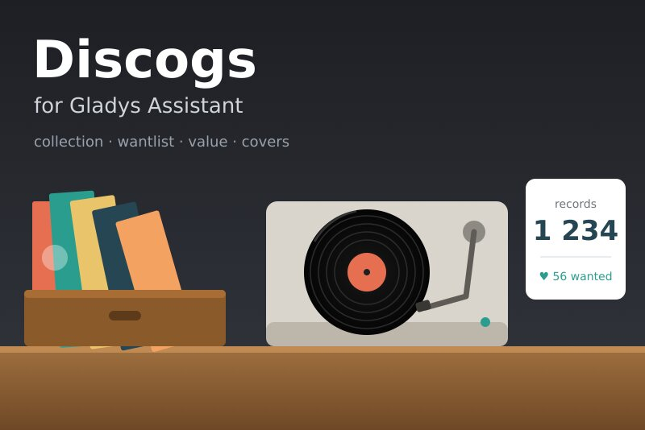
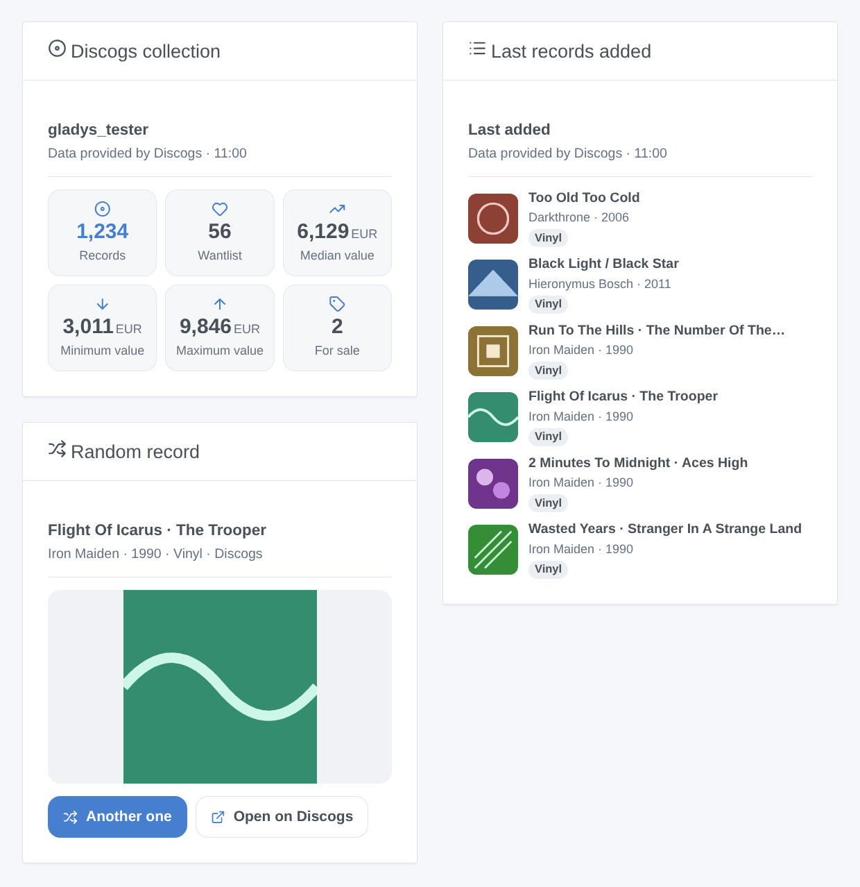
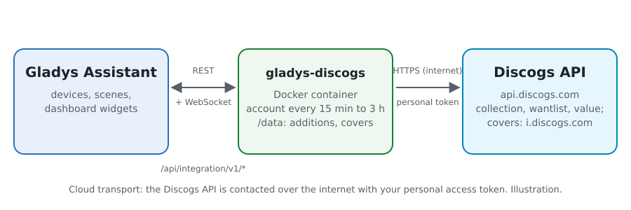
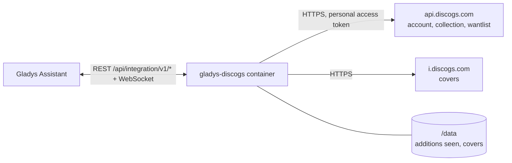
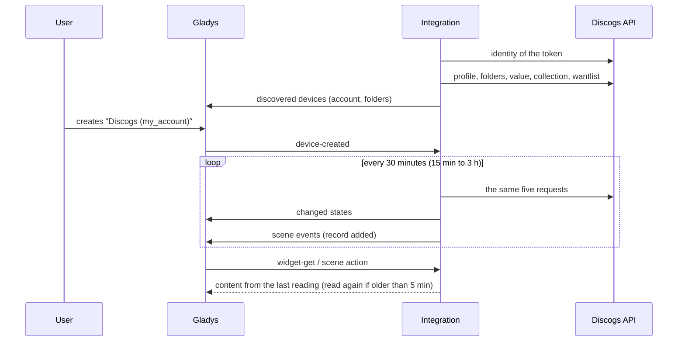

# Gladys Discogs

**English** · [Français](README.fr.md) · [Deutsch](README.de.md) · [Español](README.es.md)

[](LICENSE)
[](https://github.com/William-De71/gladys-discogs/releases)
[](https://github.com/William-De71/gladys-discogs/actions/workflows/release.yml)
[](https://gladysassistant.com)



[Gladys Assistant](https://gladysassistant.com) external integration for your **[Discogs](https://www.discogs.com) record collection**: records, wantlist, value of the collection and folders as devices, new additions as scene triggers, and widgets with the covers. It uses the official Discogs API with a personal access token of your account.

User documentation: [English](docs/en.md) · [Français](docs/fr.md) · [Deutsch](docs/de.md) · [Español](docs/es.md).

> Community integration, not affiliated with nor endorsed by Discogs. Data provided by Discogs.

## Features

- **The account device**: records in the collection, in the wantlist and for sale, minimum / median / maximum value of the collection (estimated by Discogs from the marketplace sales), last record added.
- **One device per folder** of the collection ("Vinyl", "CD"…), with its count of records.
- **2 scene triggers**: a record added to the collection (filtered by folder and by format), a record added to the wantlist.
- **7 scene actions**: a random record ("what do I play tonight?"), search a barcode, add a release to the collection, add it to / remove it from the wantlist, price of a record on the marketplace, the collection in a sentence.
- **3 dashboard widgets**: the collection at a glance, the last records added (with covers), a random record with its large cover and a button to draw another one.
- **Configuration buttons**: test the connection, diagnostic.
- Five requests per reading (every 15 minutes to 3 hours, 30 minutes by default), one at a time, within the 60 requests per minute of the API; four languages (English, French, German, Spanish).



## How it works





At start, the integration asks Discogs which account the token belongs to (`/oauth/identity`), then reads at each reading the profile (counts, currency), the folders, the value of the collection and the first page of the collection and of the wantlist, the last added first. It publishes the states that changed and compares the two first pages with those of the previous reading to fire the scene triggers. The covers are read from the image host of Discogs only when a widget shows them.



### Transport

Cloud only (`"transports": ["cloud"]`): the catalog shows the cloud badge, and there is no "prefer the local connection" button. The integration contacts `api.discogs.com` and, for the covers, `i.discogs.com`. The token stays in Gladys and in the container; the **Diagnostic** button only shows its last four characters.

## Devices and features

| Device            | Feature                             | Category / type            | Range                    |
| ----------------- | ----------------------------------- | -------------------------- | ------------------------ |
| Discogs (account) | Records in the collection           | `counter-sensor` / integer | 0 – 10 000 000           |
| Discogs (account) | Records in the wantlist             | `counter-sensor` / integer | 0 – 10 000 000           |
| Discogs (account) | Records for sale                    | `counter-sensor` / integer | 0 – 10 000 000           |
| Discogs (account) | Collection value (min, median, max) | `currency` / decimal       | € / $ / £ as the account |
| Discogs (account) | Last record added                   | `text` / text              | —                        |
| Folder (Discogs)  | Records in the folder               | `counter-sensor` / integer | 0 – 10 000 000           |

External ids: `account:<account id>` and `folder:<account id>_<folder id>` — the numeric ids of Discogs, never the names. The values are in the currency of the Discogs account; Gladys has a unit for the euro, the dollar and the pound, the other currencies have none. `should_poll` is false: the integration reads on its own timer.

## Scene triggers, actions and widgets

| Kind    | Key                    | Use                                                                    |
| ------- | ---------------------- | ---------------------------------------------------------------------- |
| Trigger | `collection_added`     | A record added to the collection; filters: folder device, format.      |
| Trigger | `wantlist_added`       | A record added to the wantlist; filter: format.                        |
| Action  | `random_release`       | A record of the collection or of a folder, drawn at random.            |
| Action  | `search_barcode`       | The release printed with a barcode, the pressing most owned first.     |
| Action  | `add_to_collection`    | Add a release to a folder (no second copy unless asked).               |
| Action  | `add_to_wantlist`      | Add a release to the wantlist.                                         |
| Action  | `remove_from_wantlist` | Remove a release from the wantlist.                                    |
| Action  | `get_price`            | Copies for sale on the marketplace and the lowest price.               |
| Action  | `get_collection`       | Counts and value of the collection, and a sentence.                    |
| Widget  | `collection`           | Records, wantlist, value (min, median, max), for sale.                 |
| Widget  | `recent`               | The last records added to the collection or the wantlist, with covers. |
| Widget  | `random`               | A random record, its large cover, "Another one" and "Open on Discogs". |

The trigger variables give the release number, title, artist, year, format, label, catalog number, genre, page and cover of the record. The first reading of an account is a baseline, and the last additions seen are kept in `/data`: a restart never fires the same event twice, and a record added by a scene action fires nothing. A bulk import fires 10 events at most per reading.

Examples:

- "Record added to the collection", format Vinyl → send "New in the collection: {{artist}} – {{title}}" to your phone.
- Every Friday at 20:00 → "a random record" from the Vinyl folder → say its summary on the living room speaker.
- A barcode scanner sends its code to a scene → "search a barcode", then "add to the collection" with the release number found.

## Requirements

- Gladys Assistant **5.3.0** or later (widgets, scene triggers and actions of external integrations, catalog keywords of Gladys 5.3). Older instances cannot install the integration.
- A Discogs account and a **personal access token**: on discogs.com, Settings → Developers → **Generate new token**.

## Installation

- **From the store** of Gladys (Integrations → External integrations), in one click, once indexed.
- **From the repository URL**: `https://github.com/William-De71/gladys-discogs`.
- **Developer mode**: build the image locally (`docker build -t gladys-discogs .`) and install it from Gladys.

## Configuration

| Field                  | Description                                                                         |
| ---------------------- | ----------------------------------------------------------------------------------- |
| Personal access token  | The token of Settings → Developers on discogs.com (secret, required).               |
| Reading of the account | Every 15 minutes, 30 minutes (default), hour or 3 hours. Five requests per reading. |
| Currency of the prices | Currency of the "price of a record" action. Default: the one of the account.        |
| Language of the texts  | Feature names, scene summaries and outputs.                                         |

Buttons: **Test the connection** (reads the account now and offers its devices) and **Diagnostic** (writes the account, the counts, the last additions seen, the last error and the rate limit left to the Logs tab, the token hidden).

## Usage

1. Generate a token on discogs.com (Settings → Developers), paste it, save and press **Test the connection**.
2. In the **Discover** tab, create the account device and the folders you want.
3. Add the **Discogs collection**, **Last records added** and **Random record** widgets to a dashboard, and build scenes with the triggers and actions above.

## Development

```bash
npm install
npm test                       # node --test, never touches the network
npm run lint && npm run format:check
npx github:GladysAssistant/integration-store . --skip-image-check
scripts/build-cover.sh         # cover.jpg from docs/assets/cover.svg
docs/illustrations/render.sh   # docs/assets/widgets.<lang>.png
node .github/scripts/release.mjs next
```

Locally, the SDK reads `GLADYS_HOST_API_URL`, `GLADYS_INTEGRATION_TOKEN` and `GLADYS_INTEGRATION_SELECTOR`; `DISCOGS_API_URL` points the integration to another API root (a mock); `DEBUG=gladys-integration-sdk` shows the SDK logs and checks every widget content. The tests use real answers of the Discogs API, reduced (`test/fixtures/`). The rules of the project are in [CLAUDE.md](CLAUDE.md).

## Release process


Every merge on `main` runs the CI, then computes the version from the [Conventional Commits](https://www.conventionalcommits.org/) since the last tag: `feat` → minor, `fix` / `perf` → patch, `!` or `BREAKING CHANGE` → major (a minor below 1.0.0); `docs`, `chore`, `ci`, `test`, `style`, `refactor`, `build` alone publish nothing. The changelog section is generated, the tag pushed, the multi-architecture image built, then `main` receives the release commit, the GitHub Release is created and a last job checks the public image, the store validator and the topic.

- The pull request title becomes the squash commit, then the changelog line: write it in English, for the user (`pr-title.yml` checks it). Never edit `CHANGELOG.md` by hand.
- 1.0.0 is a decision: Actions → Release → Run workflow with `release-as: 1.0.0`. `dry-run` shows the version and the notes without publishing.
- **Protected branch**: the release pushes its commit to `main` with `GITHUB_TOKEN`. With a ruleset on `main` stricter than "no deletion, no force-push", add GitHub Actions to its bypass list (or push through a GitHub App), otherwise the publish job fails with instructions.
- After the first release, make the `ghcr.io` package public (Package settings → Change visibility), or Gladys cannot pull it.

## Troubleshooting

See [docs/en.md](docs/en.md#troubleshooting). Report issues with the versions of Gladys and of the integration, the release or the feature concerned, and the lines of the **Diagnostic** button — never your token.

## Contributing

Issues and pull requests are welcome. Run `npm run format:check && npm run lint && npm test` before opening a pull request, and keep every external id and stored key unchanged (see [CLAUDE.md](CLAUDE.md)).

## Security

See [SECURITY.md](SECURITY.md): report vulnerabilities privately. The personal access token is a `secret` field: never logged, never sent anywhere but to `api.discogs.com`. The integration runs read-only, as a non-root user, in its container, and only reads covers from `i.discogs.com`.

## Screenshots to come

The images above are illustrations, not screenshots. Real screenshots will go in `docs/assets/screenshots/` (PNG, 1280 × 800): `configuration.png`, `discovery.png`, `device.png`, `scene.png`.

## License

[Apache License 2.0](LICENSE) — see also [NOTICE](NOTICE). The data come from [Discogs](https://www.discogs.com) through its [official API](https://www.discogs.com/developers), under the Discogs API Terms of Use: the widgets show "Data provided by Discogs". Discogs is a trademark of Zink Media, LLC. Thanks to the Gladys documentation and SDK.
