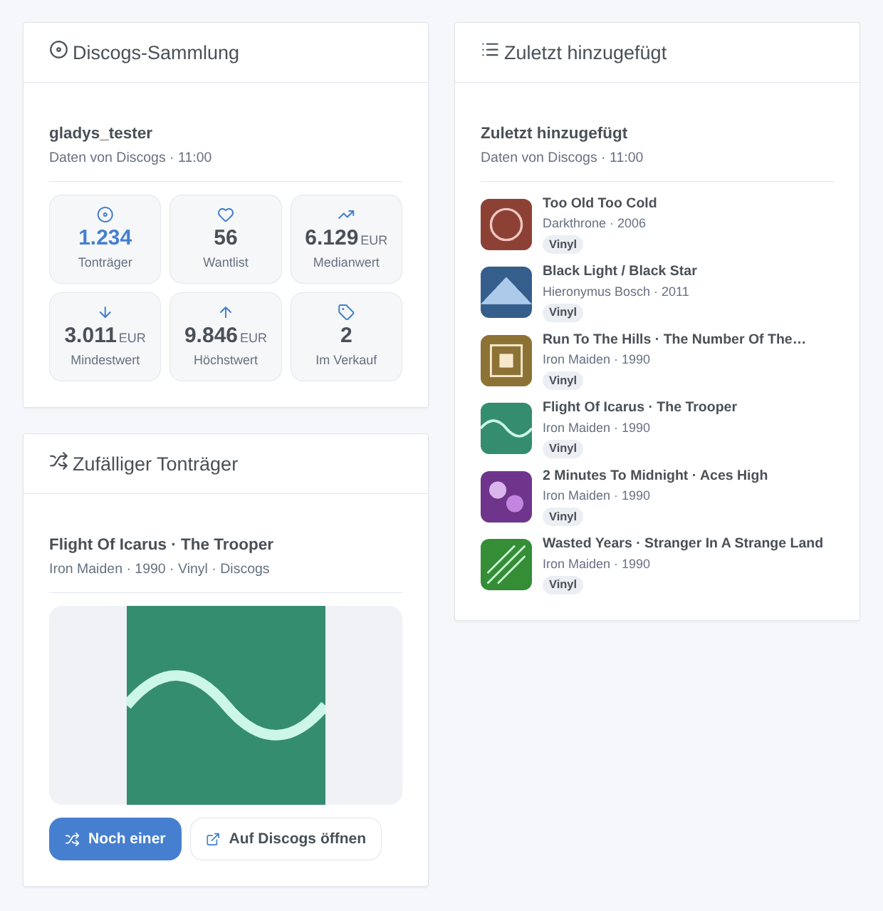

# Discogs

## Überblick

Diese Integration bringt deine **Discogs-Plattensammlung** in Gladys: die **Tonträger** deiner Sammlung und deiner **Wantlist**, die Tonträger, die du **verkaufst**, den von Discogs geschätzten **Wert** der Sammlung (Minimum, Median, Maximum) und den **zuletzt hinzugefügten Tonträger**, dazu ein Gerät pro **Ordner** der Sammlung („Vinyl“, „CD“…). Lass dich benachrichtigen, wenn ein Tonträger in die Sammlung kommt, lass Gladys die Platte des Abends ziehen, such einen Strichcode oder füge per Szene einen Tonträger zu deiner Sammlung hinzu, und zeig deine letzten Funde mit ihren Covern auf einem Dashboard.

Die Daten kommen von der **offiziellen Discogs-API**, mit einem **persönlichen Zugriffstoken** deines Kontos. Das Konto wird standardmäßig alle 30 Minuten abgefragt: jedes Mal fünf Anfragen, eine nach der anderen, weit unter den 60 Anfragen pro Minute, die Discogs erlaubt. Wie es die Nutzungsbedingungen der API verlangen, zeigen die Widgets „Daten von Discogs“.

Es ist eine **Cloud**-Integration: Sie kontaktiert `api.discogs.com` und für die Cover `i.discogs.com`. Das Token kann deine Sammlung und deine Wantlist lesen und ändern; es bleibt in Gladys und wird nie in die Logs geschrieben.

## Voraussetzungen

- Gladys Assistant 5.3.0 oder neuer.
- Ein Discogs-Konto und ein persönliches Zugriffstoken: Öffne auf discogs.com **Settings → Developers** und klick auf **Generate new token**. Das Token ist eine Zeichenkette aus 40 Buchstaben und Ziffern; halte es geheim.

## Konfiguration

| Feld                       | Was du eingibst                                                                                                                                        |
| -------------------------- | ------------------------------------------------------------------------------------------------------------------------------------------------------ |
| Persönliches Zugriffstoken | Das Token aus Settings → Developers auf discogs.com.                                                                                                   |
| Abfrage des Kontos         | Alle 15 Minuten, 30 Minuten (Standard), stündlich oder alle 3 Stunden. Ein neuer Tonträger wird bei der nächsten Abfrage erkannt.                      |
| Währung der Preise         | Die Währung der Aktion „Preis eines Tonträgers“. Standard: die deines Kontos. Der Wert der Sammlung ist immer in der Währung des Kontos.               |
| Sprache der Texte          | Namen der Funktionen, Zusammenfassungen in Szenen und Ausgaben. Automatisch: die Sprache deines Dashboards, sobald ein Discogs-Widget angezeigt wurde. |

Die Knöpfe unter dem Formular:

- **Verbindung testen**: liest dein Konto sofort, zeigt die Zähler und den zuletzt hinzugefügten Tonträger und bietet die Geräte im Reiter „Geräteerkennung“ an.
- **Diagnose**: schreibt Konto, Zähler, zuletzt gesehene Zugänge, letzten Fehler und verbleibendes Anfragekontingent in den Reiter Logs (das Token verborgen), für eine Fehlermeldung.

## Verwendung

### Geräte

Öffne nach dem Speichern den Reiter **Geräteerkennung** der Integration und erstelle die Geräte, die du möchtest:

- **Discogs (dein Konto)**: Tonträger in der Sammlung, in der Wantlist, im Verkauf; Wert der Sammlung (Minimum, Median, Maximum) in der Währung deines Kontos; zuletzt hinzugefügter Tonträger („Künstler – Titel“).
- **Ein Gerät pro Ordner** („Vinyl (Discogs)“, „CD (Discogs)“…): die Tonträger im Ordner. Sie dienen auch als Filter in den Szenen und im Widget „Zufälliger Tonträger“.

Die Werte folgen den Abfragen der Integration; Gladys speichert den Verlauf der Zähler und des Werts.

### Dashboard-Widgets

- **Discogs-Sammlung**: Tonträger, Wantlist, mittlerer, minimaler und maximaler Wert, Tonträger im Verkauf.
- **Zuletzt hinzugefügt**: die 1 bis 12 letzten Tonträger der Sammlung oder der Wantlist, als Cover oder als Liste; ein Tippen öffnet die Details und den Link zur Seite auf Discogs.
- **Zufälliger Tonträger**: ein Tonträger aus der Sammlung oder aus dem in seinen Einstellungen gewählten Ordner, mit großem Cover; **Noch einer** zieht einen neuen, **Auf Discogs öffnen** öffnet seine Seite.

### Szenen

Auslöser: **Tonträger zur Sammlung hinzugefügt** (Filter: ein Ordner-Gerät, ein Format wie Vinyl oder CD) und **Tonträger zur Wantlist hinzugefügt** (Filter: ein Format). Ihre Variablen liefern Release-Nummer, Titel, Künstler, Jahr, Format, Label, Katalognummer, Genre, Seite und Cover des Tonträgers. Die erste Abfrage dient als Ausgangsbasis; ein Tonträger, der durch eine Szenen-Aktion hinzugefügt wurde, löst nichts aus; ein Massenimport löst höchstens 10 Ereignisse pro Abfrage aus.

Aktionen:

- **Discogs: ein zufälliger Tonträger**, aus der ganzen Sammlung oder einem Ordner;
- **Strichcode suchen**: die Veröffentlichung, auf der er tatsächlich gedruckt ist (EAN, UPC), die meistbesessene Pressung zuerst;
- **zur Sammlung hinzufügen**: eine Release-Nummer („644773“) oder die Adresse ihrer Seite, in einen Ordner (standardmäßig „Uncategorized“); kein zweites Exemplar, außer „Weiteres Exemplar hinzufügen“ ist angehakt;
- **zur Wantlist hinzufügen** und **von der Wantlist entfernen**;
- **Preis eines Tonträgers**: die Angebote auf dem Marktplatz und der niedrigste Preis;
- **meine Sammlung**: die Zähler, der Wert und ein fertiger Satz für eine Nachricht.

Beispiele:

- Wenn „Tonträger zur Sammlung hinzugefügt“ mit dem Format Vinyl auslöst → „Neu in der Sammlung: {{triggerEvent.data.artist}} – {{triggerEvent.data.title}}“ an dein Handy schicken.
- Jeden Freitag um 20:00 Uhr → „Discogs: ein zufälliger Tonträger“ aus dem Ordner Vinyl → die Zusammenfassung über den Lautsprecher im Wohnzimmer ansagen.
- Ein Strichcode-Scanner schickt seinen Code an eine Szene → „Strichcode suchen“, dann „zur Sammlung hinzufügen“ mit der gefundenen Release-Nummer.

### Transport

Nur Cloud: Der Katalog zeigt das Cloud-Abzeichen, eine lokale Verbindung gibt es nicht. Die Integration fragt bei jeder Abfrage `api.discogs.com` nach deinem Konto und `i.discogs.com` nach den Covern, die die Widgets anzeigen.

## Fehlerbehebung

- **„Discogs hat das Token abgelehnt“**: Das Token wurde widerrufen oder falsch eingegeben; erzeuge in Settings → Developers ein neues und füge es erneut ein.
- **„Zu viele Anfragen an Discogs“**: Die API erlaubt 60 Anfragen pro Minute und Token, geteilt mit allen anderen Tools, die es nutzen; die Integration wartet eine Minute und macht dann von selbst weiter.
- **Kein Wert der Sammlung**: Discogs schätzt ihn nur für Tonträger, die auf seinem Marktplatz verkauft wurden; bis dahin bleiben die Wert-Funktionen leer.
- **Ein neuer Tonträger hat den Auslöser nicht gestartet**: Er wird bei der nächsten Abfrage erkannt (standardmäßig nach 30 Minuten); ein Tonträger, der durch eine Gladys-Szene hinzugefügt wurde, startet ihn nie.
- **„Strichcode suchen“ findet nichts**: Der Strichcode ist bei dieser Veröffentlichung auf Discogs nicht eingetragen; such sie auf discogs.com und verwende ihre Nummer.
- Für eine Fehlermeldung drück auf **Diagnose** und häng die Zeilen „Discogs diagnostic“ aus dem Reiter Logs an, zusammen mit den Versionen von Gladys und der Integration — niemals dein Token.
