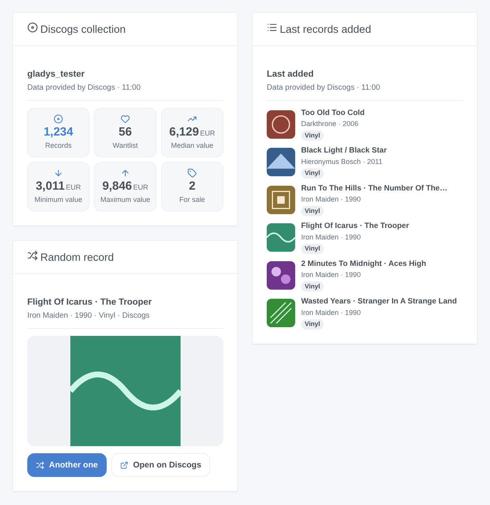

# Discogs

## Overview

This integration brings your **Discogs record collection** into Gladys: the **records** of your collection and of your **wantlist**, the records you **sell**, the **value** of the collection estimated by Discogs (minimum, median, maximum) and the **last record added**, plus one device per **folder** of the collection ("Vinyl", "CD"…). Be told when a record enters the collection, let Gladys draw the record of the evening, look up a barcode or add a record to your collection from a scene, and show your last finds with their covers on a dashboard.

The data come from the **official Discogs API**, with a **personal access token** of your account. The account is read every 30 minutes by default: five requests each time, one at a time, far below the 60 requests per minute Discogs allows. As the terms of the API ask, the widgets show "Data provided by Discogs".

It is a **cloud** integration: it contacts `api.discogs.com`, and `i.discogs.com` for the covers. The token can read and change your collection and your wantlist; it stays in Gladys and is never written to the logs.

## Prerequisites

- Gladys Assistant 5.3.0 or later.
- A Discogs account and a personal access token: on discogs.com, open **Settings → Developers** and press **Generate new token**. The token is a line of 40 letters and digits; keep it secret.

## Configuration

| Field                  | What to enter                                                                                                                          |
| ---------------------- | -------------------------------------------------------------------------------------------------------------------------------------- |
| Personal access token  | The token of Settings → Developers on discogs.com.                                                                                     |
| Reading of the account | Every 15 minutes, 30 minutes (default), hour or 3 hours. A new record is seen at the next reading.                                     |
| Currency of the prices | The currency of the "price of a record" action. Default: the one of your account. The value of the collection is always in the latter. |
| Language of the texts  | Feature names, scene summaries and outputs. Automatic: the language of your dashboard once a Discogs widget has been displayed.        |

The buttons under the form:

- **Test the connection**: reads your account now, shows the counts and the last record added, and offers the devices on the Discover tab.
- **Diagnostic**: writes the account, the counts, the last additions seen, the last error and the rate limit left to the Logs tab (the token hidden), for a report.

## Usage

### Devices

After saving, open the **Discover** tab of the integration and create the devices you want:

- **Discogs (your account)**: records in the collection, in the wantlist, for sale; collection value (minimum, median, maximum) in the currency of your account; last record added ("Artist – Title").
- **One device per folder** ("Vinyl (Discogs)", "CD (Discogs)"…): the records in the folder. They also serve as filters in the scenes and in the "Random record" widget.

The values follow the readings of the integration; Gladys keeps the history of the counts and of the value.

### Dashboard widgets

- **Discogs collection**: records, wantlist, median, minimum and maximum value, records for sale.
- **Last records added**: the 1 to 12 last records of the collection or of the wantlist, as covers or as a list; a tap opens the details and the link to the page on Discogs.
- **Random record**: a record of the collection, or of the folder chosen in its settings, with its large cover; **Another one** draws a new one, **Open on Discogs** opens its page.

### Scenes

Triggers: **record added to the collection** (filters: a folder device, a format such as Vinyl or CD) and **record added to the wantlist** (filter: a format). Their variables give the release number, the title, the artist, the year, the format, the label, the catalog number, the genre, the page and the cover of the record. The first reading is a baseline; a record added by a scene action fires nothing; a bulk import fires 10 events at most per reading.

Actions:

- **A random record**, from the whole collection or a folder;
- **Search a barcode**: the release really printed with it (EAN, UPC), the pressing most owned first;
- **Add to the collection**: a release number ("644773") or the address of its page, in a folder ("Uncategorized" by default); no second copy unless "Add another copy" is ticked;
- **Add to the wantlist** and **remove from the wantlist**;
- **Price of a record**: the copies for sale on the marketplace and the lowest price;
- **My collection**: the counts, the value and a sentence ready for a message.

Examples:

- When "Record added to the collection" fires with the format Vinyl → send "New in the collection: {{triggerEvent.data.artist}} – {{triggerEvent.data.title}}" to your phone.
- Every Friday at 20:00 → "A random record" from the Vinyl folder → say its summary on the living room speaker.
- A barcode scanner sends its code to a scene → "Search a barcode", then "Add to the collection" with the release number found.

### Transport

Cloud only: the catalog shows the cloud badge, there is no local connection. The integration asks `api.discogs.com` for your account at each reading and `i.discogs.com` for the covers the widgets show.

## Troubleshooting

- **"Discogs refused the token"**: the token was revoked or mistyped; generate a new one in Settings → Developers and paste it again.
- **"Too many requests to Discogs"**: the API allows 60 requests per minute per token, shared with any other tool using it; the integration waits a minute and starts again on its own.
- **No value of the collection**: Discogs only estimates it for records that have sold on its marketplace; the value features stay empty until then.
- **A new record did not fire the trigger**: it is seen at the next reading (30 minutes by default); a record added by a Gladys scene never fires it.
- **"Search a barcode" finds nothing**: the barcode is not filled in on Discogs for this release; search for it on discogs.com and use its number.
- For a report, press **Diagnostic** and attach the "Discogs diagnostic" lines of the Logs tab, with the versions of Gladys and of the integration — never your token.
