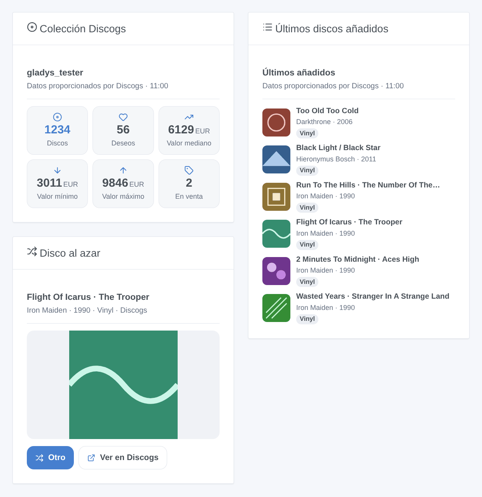

# Discogs

## Presentación

Esta integración lleva a Gladys tu **colección de discos de Discogs**: los **discos** de tu colección y de tu **lista de deseos**, los discos que **vendes**, el **valor** de la colección estimado por Discogs (mínimo, mediano, máximo) y el **último disco añadido**, además de un dispositivo por **carpeta** de la colección («Vinilos», «CD»…). Recibe un aviso cuando entra un disco en la colección, deja que Gladys elija el disco de la noche, busca un código de barras o añade un disco a tu colección desde una escena, y muestra tus últimos hallazgos con sus portadas en un panel.

Los datos proceden de la **API oficial de Discogs**, con un **token de acceso personal** de tu cuenta. La cuenta se lee cada 30 minutos por defecto: cinco solicitudes cada vez, una tras otra, muy por debajo de las 60 solicitudes por minuto que permite Discogs. Tal como piden las condiciones de la API, los widgets muestran «Datos proporcionados por Discogs».

Es una integración en la **nube**: contacta con `api.discogs.com`, y con `i.discogs.com` para las portadas. El token puede leer y modificar tu colección y tu lista de deseos; se queda en Gladys y nunca se escribe en los registros.

## Requisitos

- Gladys Assistant 5.3.0 o posterior.
- Una cuenta de Discogs y un token de acceso personal: en discogs.com, abre **Settings → Developers** y pulsa **Generate new token**. El token es una cadena de 40 letras y cifras; guárdalo en secreto.

## Configuración

| Campo                    | Qué indicar                                                                                                                                     |
| ------------------------ | ----------------------------------------------------------------------------------------------------------------------------------------------- |
| Token de acceso personal | El token de Settings → Developers en discogs.com.                                                                                               |
| Lectura de la cuenta     | Cada 15 minutos, 30 minutos (por defecto), hora o 3 horas. Un disco nuevo se ve en la siguiente lectura.                                        |
| Moneda de los precios    | La moneda de la acción «precio de un disco». Por defecto: la de tu cuenta. El valor de la colección viene siempre en la moneda de la cuenta.    |
| Idioma de los textos     | Nombres de las funcionalidades, resúmenes de escena y salidas. Automático: el idioma de tu panel en cuanto se ha mostrado un widget de Discogs. |

Los botones bajo el formulario:

- **Probar la conexión**: lee tu cuenta en el momento, muestra los recuentos y el último disco añadido, y ofrece los dispositivos en la pestaña «Detección».
- **Diagnóstico**: escribe en la pestaña de registros la cuenta, los recuentos, las últimas novedades vistas, el último error y el margen de solicitudes que queda (con el token oculto), para adjuntarlo a una incidencia.

## Uso

### Dispositivos

Después de guardar, abre la pestaña **Detección** de la integración y crea los dispositivos que quieras:

- **Discogs (tu cuenta)**: discos en la colección, en la lista de deseos, a la venta; valor de la colección (mínimo, mediano, máximo) en la moneda de tu cuenta; último disco añadido («Artista – Título»).
- **Un dispositivo por carpeta** («Vinilos (Discogs)», «CD (Discogs)»…): los discos de la carpeta. También sirven de filtro en las escenas y en el widget «Disco al azar».

Los valores siguen las lecturas de la integración; Gladys guarda el historial de los recuentos y del valor.

### Widgets del panel

- **Colección Discogs**: discos, lista de deseos, valor mediano, mínimo y máximo, discos a la venta.
- **Últimos discos añadidos**: los 1 a 12 últimos discos de la colección o de la lista de deseos, como portadas o como lista; al tocar uno se abren los detalles y el enlace a su página en Discogs.
- **Disco al azar**: un disco de la colección, o de la carpeta elegida en sus ajustes, con su portada grande; **Otro** saca uno nuevo, **Ver en Discogs** abre su página.

### Escenas

Desencadenantes: **disco añadido a la colección** (filtros: un dispositivo carpeta, un formato como Vinilo o CD) y **disco añadido a la lista de deseos** (filtro: un formato). Sus variables dan el número de edición, el título, el artista, el año, el formato, el sello, el número de catálogo, el género, la página y la portada del disco. La primera lectura sirve de referencia; un disco añadido por una acción de escena no lanza nada; una importación masiva lanza como mucho 10 eventos por lectura.

Acciones:

- **Un disco al azar**, de toda la colección o de una carpeta;
- **Buscar un código de barras**: la edición que lo lleva impreso de verdad (EAN, UPC), primero el prensaje más poseído;
- **Añadir a la colección**: un número de edición («644773») o la dirección de su página, en una carpeta («Uncategorized» por defecto); sin segunda copia salvo que marques «Añadir otra copia»;
- **Añadir a la lista de deseos** y **quitar de la lista de deseos**;
- **Precio de un disco**: las copias a la venta en el mercado y el precio más bajo;
- **Mi colección**: los recuentos, el valor y una frase lista para un mensaje.

Ejemplos:

- Cuando se lanza «Disco añadido a la colección» con el formato Vinilo → envía «Nuevo en la colección: {{triggerEvent.data.artist}} – {{triggerEvent.data.title}}» a tu móvil.
- Todos los viernes a las 20:00 → «Un disco al azar» de la carpeta Vinilos → di su resumen por el altavoz del salón.
- Un lector de códigos de barras envía su código a una escena → «Buscar un código de barras» y luego «Añadir a la colección» con el número de edición encontrado.

### Transporte

Solo nube: el catálogo muestra la insignia de nube y no hay conexión local. La integración consulta tu cuenta en `api.discogs.com` en cada lectura y las portadas que muestran los widgets en `i.discogs.com`.

## Solución de problemas

- **«Discogs rechazó el token»**: el token se revocó o se escribió mal; genera uno nuevo en Settings → Developers y vuelve a pegarlo.
- **«Demasiadas solicitudes a Discogs»**: la API permite 60 solicitudes por minuto y por token, compartidas con cualquier otra herramienta que lo use; la integración espera un minuto y vuelve a empezar sola.
- **Sin valor de la colección**: Discogs solo lo estima para los discos que se han vendido en su mercado; hasta entonces, las funcionalidades de valor se quedan vacías.
- **Un disco nuevo no lanzó el desencadenante**: se ve en la siguiente lectura (30 minutos por defecto); un disco añadido por una escena de Gladys nunca lo lanza.
- **«Buscar un código de barras» no encuentra nada**: el código de barras no está indicado en Discogs para esa edición; búscala en discogs.com y usa su número.
- Para informar de un problema, pulsa **Diagnóstico** y adjunta las líneas «Discogs diagnostic» de la pestaña de registros, con las versiones de Gladys y de la integración — nunca tu token.
