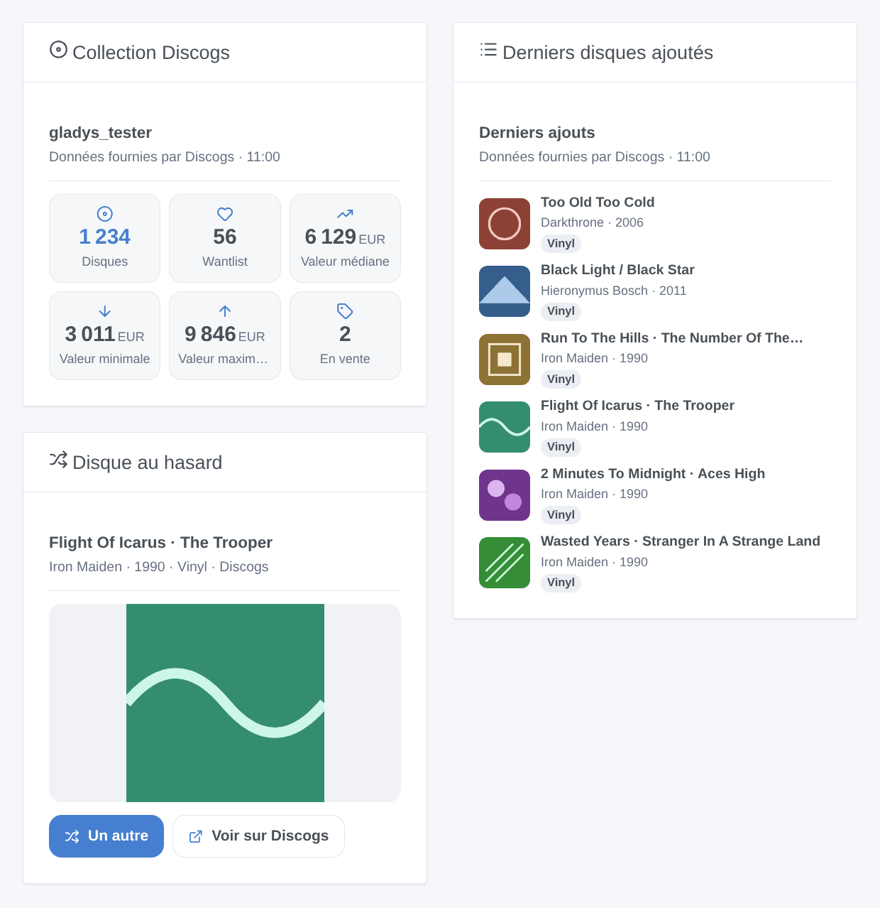

# Discogs

## Présentation

Cette intégration amène votre **collection de disques Discogs** dans Gladys : les **disques** de votre collection et de votre **wantlist**, les disques que vous **vendez**, la **valeur** de la collection estimée par Discogs (minimale, médiane, maximale) et le **dernier disque ajouté**, plus un appareil par **dossier** de la collection (« Vinyles », « CD »…). Soyez prévenu quand un disque entre dans la collection, laissez Gladys tirer au sort le disque de la soirée, cherchez un code-barres ou ajoutez un disque à votre collection depuis une scène, et affichez vos dernières trouvailles avec leurs pochettes sur un tableau de bord.

Les données viennent de l’**API officielle de Discogs**, avec un **jeton d’accès personnel** de votre compte. Le compte est lu toutes les 30 minutes par défaut : cinq requêtes à chaque fois, une à la fois, bien en dessous des 60 requêtes par minute qu’autorise Discogs. Comme le demandent les conditions de l’API, les widgets affichent « Données fournies par Discogs ».

C’est une intégration **cloud** : elle contacte `api.discogs.com`, et `i.discogs.com` pour les pochettes. Le jeton peut lire et modifier votre collection et votre wantlist ; il reste dans Gladys et n’est jamais écrit dans les journaux.

## Prérequis

- Gladys Assistant 5.3.0 ou plus récent.
- Un compte Discogs et un jeton d’accès personnel : sur discogs.com, ouvrez **Settings → Developers** et appuyez sur **Generate new token**. Le jeton est une suite de 40 lettres et chiffres ; gardez-le secret.

## Configuration

| Champ                   | Que saisir                                                                                                                                      |
| ----------------------- | ----------------------------------------------------------------------------------------------------------------------------------------------- |
| Jeton d’accès personnel | Le jeton de Settings → Developers sur discogs.com.                                                                                              |
| Lecture du compte       | Toutes les 15 min, 30 min (par défaut), toutes les heures ou toutes les 3 h. Un nouveau disque est vu à la lecture suivante.                    |
| Devise des prix         | La devise de l’action « prix d’un disque ». Par défaut : celle de votre compte. La valeur de la collection est toujours dans cette dernière.    |
| Langue des textes       | Noms des fonctionnalités, résumés et sorties des scènes. Automatique : la langue de votre tableau de bord dès qu’un widget Discogs est affiché. |

Les boutons sous le formulaire :

- **Tester la connexion** : lit votre compte tout de suite, montre les nombres et le dernier disque ajouté, et propose les appareils dans l’onglet Découverte.
- **Diagnostic** : écrit dans l’onglet Journaux le compte, les nombres, les derniers ajouts vus, la dernière erreur et le quota restant (jeton masqué), pour un signalement.

## Utilisation

### Appareils

Après l’enregistrement, ouvrez l’onglet **Découverte** de l’intégration et créez les appareils voulus :

- **Discogs (votre compte)** : disques dans la collection, dans la wantlist, en vente ; valeur de la collection (minimale, médiane, maximale) dans la devise de votre compte ; dernier disque ajouté (« Artiste – Titre »).
- **Un appareil par dossier** (« Vinyles (Discogs) », « CD (Discogs) »…) : les disques du dossier. Ils servent aussi de filtres dans les scènes et dans le widget « Disque au hasard ».

Les valeurs suivent les lectures de l’intégration ; Gladys garde l’historique des nombres et de la valeur.

### Widgets du tableau de bord

- **Collection Discogs** : disques, wantlist, valeur médiane, minimale et maximale, disques en vente.
- **Derniers disques ajoutés** : les 1 à 12 derniers disques de la collection ou de la wantlist, en pochettes ou en liste ; un appui ouvre le détail et le lien vers la page sur Discogs.
- **Disque au hasard** : un disque de la collection, ou du dossier choisi dans ses réglages, avec sa grande pochette ; **Un autre** en tire un nouveau, **Voir sur Discogs** ouvre sa page.

### Scènes

Déclencheurs : **disque ajouté à la collection** (filtres : un appareil dossier, un format comme Vinyle ou CD) et **disque ajouté à la wantlist** (filtre : un format). Leurs variables donnent le numéro de l’édition, le titre, l’artiste, l’année, le format, le label, le numéro de catalogue, le genre, la page et la pochette du disque. La première lecture sert de référence ; un disque ajouté par une action de scène ne lance rien ; un import en masse lance au plus 10 événements par lecture.

Actions :

- **Discogs : un disque au hasard**, dans toute la collection ou dans un dossier ;
- **Chercher un code-barres** : l’édition qui le porte vraiment (EAN, UPC), le pressage le plus possédé en premier ;
- **Ajouter à la collection** : un numéro d’édition (« 644773 ») ou l’adresse de sa page, dans un dossier (« Uncategorized » par défaut) ; pas de second exemplaire, sauf si « Ajouter un autre exemplaire » est coché ;
- **Ajouter à la wantlist** et **retirer de la wantlist** ;
- **Prix d’un disque** : les exemplaires en vente sur le marché et le prix le plus bas ;
- **Ma collection** : les nombres, la valeur et une phrase prête pour un message.

Exemples :

- Quand « Disque ajouté à la collection » se déclenche avec le format Vinyle → envoyer « Nouveau dans la collection : {{triggerEvent.data.artist}} – {{triggerEvent.data.title}} » sur votre téléphone.
- Tous les vendredis à 20 h → « Un disque au hasard » du dossier Vinyles → lire son résumé sur l’enceinte du salon.
- Un lecteur de codes-barres envoie son code à une scène → « Chercher un code-barres », puis « Ajouter à la collection » avec le numéro d’édition trouvé.

### Transport

Cloud uniquement : le catalogue affiche le badge cloud, il n’y a pas de connexion locale. L’intégration interroge `api.discogs.com` sur votre compte à chaque lecture, et `i.discogs.com` pour les pochettes affichées par les widgets.

## Dépannage

- **« Discogs a refusé le jeton »** : le jeton a été révoqué ou mal saisi ; générez-en un nouveau dans Settings → Developers et collez-le à nouveau.
- **« Trop de requêtes vers Discogs »** : l’API autorise 60 requêtes par minute et par jeton, partagées avec tout autre outil qui l’utilise ; l’intégration attend une minute et repart d’elle-même.
- **Pas de valeur pour la collection** : Discogs ne l’estime que pour les disques qui se sont vendus sur son marché ; les fonctionnalités de valeur restent vides d’ici là.
- **Un nouveau disque n’a pas lancé le déclencheur** : il est vu à la lecture suivante (30 minutes par défaut) ; un disque ajouté par une scène Gladys ne le lance jamais.
- **« Chercher un code-barres » ne trouve rien** : le code-barres n’est pas renseigné sur Discogs pour cette édition ; cherchez-la sur discogs.com et utilisez son numéro.
- Pour un signalement, appuyez sur **Diagnostic** et joignez les lignes « Discogs diagnostic » de l’onglet Journaux, avec les versions de Gladys et de l’intégration — jamais votre jeton.
